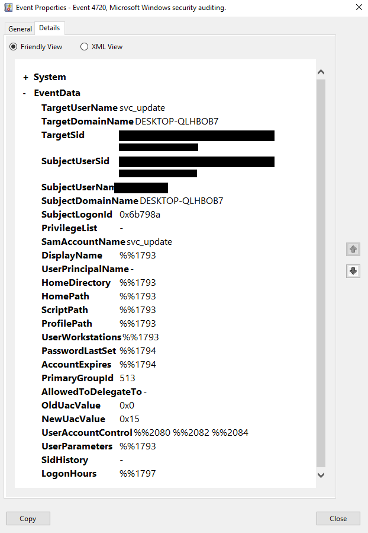

# Incident Report: Unauthorized Local Account Creation and Privilege Escalation

**Report ID:** INC-2026-08-12-01\
**Classification:** Internal — Lab Exercise\
**Exercise premise:** the account creation and privilege escalation were performed deliberately on this lab's own endpoint to generate the evidence analyzed here. The report is written from the position of an analyst who encounters the resulting events without that context; the reasoning, triage, and escalation decision reflect only what the Security Event Log supports, which is the point of the exercise.\
**Framework:** NIST SP 800-61 Rev 3, *Incident Response Recommendations and Considerations for Cybersecurity Risk Management: A CSF 2.0 Community Profile*. See [`CSF_MAPPING.md`](CSF_MAPPING.md) for this report mapped to specific CSF 2.0 Subcategories.\
**Severity:** High\
**Status:** Escalated — Pending Tier 2 Investigation

---

## 1. Executive Summary

On August 12, 2026, a local Windows account (`svc_update`) was created on a domain-joined endpoint (`DESKTOP-QLHBOB7`) and immediately added to the local `Administrators` group, granting it full administrative control of the machine. Both actions trace to the machine's known local administrator account (`winadmin`), but attribution to a legitimate account does not confirm legitimate intent: a compromised administrator session would produce identical evidence. In a live environment, the next Tier 1 step would be out-of-band verification with the account owner; this lab has no independent party to query, so that step is reasoned about hypothetically rather than performed. Given confirmed privilege escalation, an account whose authorization cannot be established from the available evidence, and no supporting change record, the incident is assessed as High severity and escalated to SOC Tier 2 rather than closed at Tier 1.

## 2. Detect

*CSF 2.0: DE.AE-02, DE.AE-03, DE.AE-07*

### Indicators of Compromise

| Indicator | Value |
|---|---|
| Account name | `svc_update` |
| Account SID | `S-1-5-21-2000000001-2000000002-2000000003-1006` |
| Host | `DESKTOP-QLHBOB7` |
| Subject account (creator) | `winadmin` |
| Subject SID | `S-1-5-21-2000000001-2000000002-2000000003-1001` |
| Target group | `Administrators` (Builtin, SID `S-1-5-32-544`) |
| Password state | `PasswordLastSet` shows `<never>` (`%%1794`) in the 4720 event — expected for a newly created account, and not an indicator on its own |

Both SIDs and the subject account come from the Security log records in [`security-log-4720-4732-2026-08-12.txt`](evidence/incident-01/security-log-4720-4732-2026-08-12.txt).

The account name is a soft indicator: `svc_update` follows a legitimate-looking service-account convention, a name that blends into normal administrative activity — a pattern MITRE ATT&CK records as Masquerade Account Name (T1036.010: adversaries "will attempt to masquerade as service accounts"), not proof of malicious intent on its own.



### MITRE ATT&CK Mapping

*Mapped to MITRE ATT&CK v19.2.*

| Technique | ID | Tactic |
|---|---|---|
| Create Account: Local Account | T1136.001 | Persistence |
| Account Manipulation: Additional Local or Domain Groups | T1098.007 | Persistence, Privilege Escalation |

## 3. Respond — Incident Management

*CSF 2.0: RS.MA-02, RS.MA-03, RS.MA-04, DE.AE-08, RS.CO-02*

### Timeline of Events

*Sequence reconstruction — CSF 2.0 RS.AN-03, presented here for narrative continuity with the triage it informs.*

All times are as Event Viewer displays them on the client, which displayed local time at UTC−7 (11:38:06 AM is 18:38:06 UTC, 2:38:06 PM EDT), read directly from Windows Security Event Log entries — not estimated. The log's own UTC times, to the 100-nanosecond, are in [`security-log-4720-4732-2026-08-12.txt`](evidence/incident-01/security-log-4720-4732-2026-08-12.txt).

| Time | Event | Source |
|---|---|---|
| 11:38:06 AM | Local account `svc_update` created | Event ID 4720 |
| 11:38:06 AM | `svc_update` added to default `Users` group (logged 37 ms after the account's creation) | Event ID 4732 |
| 11:38:12 AM | `svc_update` added to `Administrators` group | Event ID 4732 |

The six-second gap between account creation and the `Administrators` addition shows two separate actions rather than one; the log alone cannot say whether they were typed or scripted. Both the `Administrators` group addition (`TargetSid S-1-5-32-544`) and the `Users` group addition (`TargetSid S-1-5-32-545`) were confirmed in full Event Detail, not inferred from the summary list. An earlier test account of the same name (`svc_update`, RID 1005) was created and deleted before the exercise; its records are the 7:49:56 AM rows in the event lists and the first three records in the log excerpt, and are not part of this incident.


### Triage & Severity Assessment

**Severity: High.** This assessment rests on completed impact, not a suspicious attempt. Both the account creation and the privilege escalation are confirmed in the Windows Security Event Log: the 4720 event records the account's creation, and the 4732 event its addition to the `Administrators` group (`TargetSid S-1-5-32-544`). A newly created account with local administrative rights on a domain-joined machine is genuine, immediate elevated access.

**Initial (Tier 1) validation performed before escalation:**
- Reviewed the full Event Detail (Subject field) for both 4720 and 4732 — not just the summary list — to identify the specific account responsible for each action.
- Confirmed the responsible account (`winadmin`) is not the local Windows built-in `Administrator` account, but a genuine standing local admin identity.
- Identified out-of-band verification with the account owner as the next required Tier 1 step. In a live environment this would determine whether the action was authorized; in a single-operator lab there is no independent party to query, so it is recorded as a procedural step, not performed.

**Why this was not closed at Tier 1 despite identifying a known account:** attribution to a legitimate credential is not confirmation of legitimate intent. A compromised administrator session is, if anything, more severe than an unknown external identity performing the same action: it means an attacker already holds working administrative credentials. Without independent confirmation of intent, Tier 1 cannot distinguish authorized administrative work from malicious activity that looks identical in the log.

### Escalation Decision

**Escalated to SOC Tier 2.** Justification: privilege escalation is confirmed and completed (not attempted), the responsible account's legitimacy could not be verified by Tier 1 means, and no change record or ticket explains the action. Tier 2 is needed for what lies beyond Tier 1's scope: reviewing the `winadmin` account's session and logon history around the incident, checking for concurrent or preceding suspicious authentication, and determining whether its credentials show signs of compromise.

## 4. Respond — Incident Analysis

*CSF 2.0: RS.AN-03*

### Root Cause Analysis

**Unresolved.** Without confirmed intent from the account owner or session-level forensic data (outside this exercise's scope), the root cause cannot be determined. Two possibilities remain open:

1. **Legitimate but undocumented administrative action** — a real but unrecorded change, reflecting a change-management gap rather than a security incident.
2. **Compromised administrative session** — an attacker operating through the `winadmin` account's existing privileges, using account creation as a persistence mechanism.

The report does not choose between them: a Tier 2 investigation exists to resolve this kind of ambiguity, and asserting certainty here would misrepresent what the evidence supports.

## 5. Respond — Mitigation

*CSF 2.0: RS.MI-01, RS.MI-02, RS.AN-06*

### Containment & Remediation Actions

Executed:

```powershell
net localgroup Administrators svc_update /delete
net user svc_update /delete
```

A follow-up `net user svc_update` query was run to confirm removal rather than trusting the delete commands' own success output; it returned `The user name could not be found.` That reply survives only as terminal output pasted at the time, not as a saved file. The removal itself is in the Security log: `svc_update` was removed from `Administrators` at 19:44:24 UTC, then removed from `Users` and deleted at 19:44:25 UTC, under the same logon session that created it ([`containment-2026-08-12.txt`](evidence/incident-01/containment-2026-08-12.txt), which also holds the pasted output). Future reports should save containment verification as output alongside the detection evidence: the evidence standard for detecting an incident should apply equally to proving it was contained.

In a live environment, containment would typically wait for Tier 2's authorization, to preserve the account and its activity for forensic review; removing it immediately can destroy evidence Tier 2 needs. This exercise contained without waiting for Tier 2, and the trade-off is recorded here.

## 6. Recover

*CSF 2.0: RC.RP-06*

This incident did not require recovery in the sense RC.RP-01 through RC.RP-05 describe: no system or service was taken offline, corrupted, or in need of restoration to a known-good state, and Section 5 removed the unauthorized account rather than restoring anything. Rev 3's RC.RP-06 calls for an after-action report documenting the incident, the response and recovery actions taken, and lessons learned; this report is that artifact. Recover is the thinnest Function this report touches, because the incident produced no recovery work.

## 7. Improvement

*CSF 2.0: ID.IM-03 — Rev 3 positions Improvement as feeding organizational practice (Table 2, Preparation and Lessons Learned) rather than as a same-level part of incident response itself. Included here because this is where that feedback originates.*

### Lessons Learned / Recommendations

- **No alerting currently exists for Event IDs 4720/4732 on this endpoint.** Both events were only found through manual, retrospective log review — a real detection gap. A future addition to this lab's SIEM coverage: a Wazuh rule correlating 4720 followed by 4732 (Administrators) for the same `TargetUserName` within a short window, surfacing this exact pattern automatically rather than requiring manual discovery.
- **No change-management record exists for local administrative actions on this endpoint.** Even in a home lab, this mirrors a common organizational gap: without a change ticket to check against, Tier 1 has no fast way to distinguish authorized administrative work from malicious activity performed with valid credentials.

## Appendix: Evidence Index

The two detail views that source this report's claims appear inline in Sections 2 and 3. All five captures, and the two log excerpts, are listed here:

| File | Shows |
|---|---|
| [`event-4720-list.png`](screenshots/incident-01/event-4720-list.png) | Security log filtered to Event ID 4720 — eight account-creation events on this host; the one at the incident timestamp (11:38:06 AM) is selected |
| [`event-4720-account-created.png`](screenshots/incident-01/event-4720-account-created.png) | Full detail view of the 4720 event *(shown inline in Section 2)* |
| [`event-4732-list.png`](screenshots/incident-01/event-4732-list.png) | Security log filtered to Event ID 4732 — fifteen group-membership events; the two from this incident (11:38:06 AM and 11:38:12 AM) are selected |
| [`event-4732-users-group-added.png`](screenshots/incident-01/event-4732-users-group-added.png) | Full detail view of the `Users` group addition (`TargetSid S-1-5-32-545`), logged at the account's creation |
| [`event-4732-group-membership-added.png`](screenshots/incident-01/event-4732-group-membership-added.png) | Full detail view of the `Administrators` group addition *(shown inline in Section 3)* |
| [`security-log-4720-4732-2026-08-12.txt`](evidence/incident-01/security-log-4720-4732-2026-08-12.txt) | The six account-creation and group-membership records of August 12 as `Get-WinEvent` printed them, with the subject account and SIDs, and the incident's three records parsed from the Security log with UTC times to the 100-nanosecond *(cited in Sections 2 and 3)* |
| [`containment-2026-08-12.txt`](evidence/incident-01/containment-2026-08-12.txt) | The containment records parsed from the Security log (removed from `Administrators`, removed from `Users`, account deleted), and the follow-up query's reply as pasted at the time *(cited in Section 5)* |
