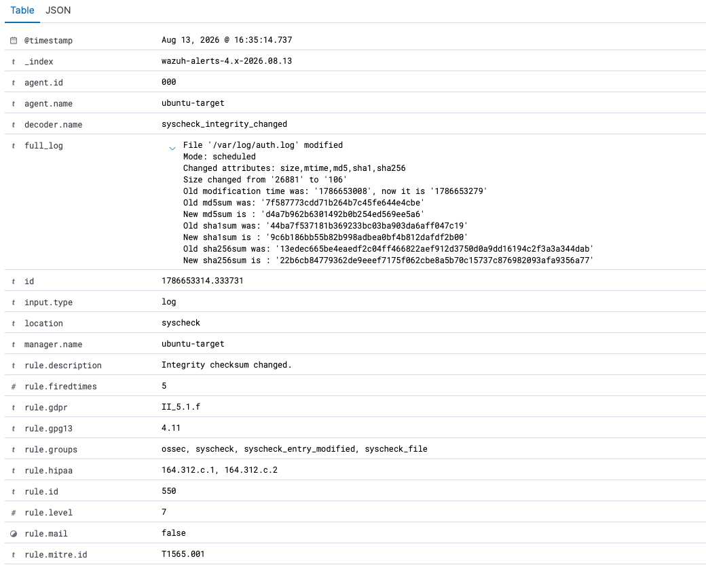

# Incident Report: Authentication Log Tampering

**Report ID:** INC-2026-08-13-01\
**Classification:** Internal — Lab Exercise\
**Framework:** NIST SP 800-61 Rev 3, *Incident Response Recommendations and Considerations for Cybersecurity Risk Management: A CSF 2.0 Community Profile*. See [`CSF_MAPPING.md`](CSF_MAPPING.md) for this report mapped to specific CSF 2.0 Subcategories.\
**Severity:** High\
**Status:** Escalated — Pending Tier 2 Investigation

---

## 1. Executive Summary

On August 13, 2026, the authentication log (`/var/log/auth.log`) on `ubuntu-target` was deliberately truncated to 106 bytes (one line) from an already-established shell session. The exercise's premise is that the operator already holds valid shell access to the host: the incident begins at the evidence tampering, not at initial access. File Integrity Monitoring (FIM) detected the change on the next scheduled scan and generated a rule 550 alert with before/after hashes and a complete diff of the destroyed content, so the tampering erased only the live copy on disk, not the evidence. Because log clearing by an actor with existing access strongly indicates deliberate, technically capable activity meant to conceal other actions, the incident is assessed as High severity and escalated to SOC Tier 2 to determine what the operator was hiding.

## 2. Detect

*CSF 2.0: DE.AE-02, DE.AE-03, DE.AE-07*

### Indicators of Compromise

| Indicator | Value |
|---|---|
| Target file | `/var/log/auth.log` |
| Host | `ubuntu-target` |
| Command executed | `sudo truncate -s 0 /var/log/auth.log` |
| Size before → after | 26,881 bytes → 106 bytes |
| MD5 before → after | `7f587773cdd71b264b7c45fe644e4cbe` → `d4a7b962b6301492b0b254ed569ee5a6` |
| SHA1 before → after | `44ba7f537181b369233bc03ba903da6aff047c19` → `9c6b186bb55b82b998adbea0bf4b812dafdf2b00` |
| SHA256 before → after | `13edec665be4eaedf2c04ff466822aef912d3750d0a9dd16194c2f3a3a344dab` → `22b6cb84779362de9eeef7175f062cbe8a5b70c15737c876982093afa9356a77` |
| Residual content | One PAM session-close line remained post-truncate ([record](evidence/incident-02/truncation-and-residual-line.txt)) |

The residual content is an indicator in its own right: even a minimal anti-forensic action (`truncate -s 0`) could not leave a perfectly empty file, because the `sudo` session that ran it wrote a PAM session-close event into the file being cleared — a self-defeating property of this technique that a different cleanup (e.g. deleting and recreating the file) might not share. The system journal shows the truncating `sudo` session opening, running `truncate`, and closing at 20:34:39 UTC, and the alert's diff shows that closing line as the only content left in the file ([`truncation-and-residual-line.txt`](evidence/incident-02/truncation-and-residual-line.txt)).

### MITRE ATT&CK Mapping

*Mapped to MITRE ATT&CK v19.2.*

| Technique | ID | Tactic | Source |
|---|---|---|---|
| Disable or Modify Tools: Clear Linux or Mac System Logs | T1685.006 (reissued from T1070.002 under ATT&CK v19) | Defense Impairment | Scenario intent |
| Data Manipulation: Stored Data Manipulation | T1565.001 | Impact | Wazuh's automatic rule 550 tag |

The two mappings differ, and the difference is recorded here rather than reconciled. Rule 550 is a generic, content-agnostic integrity-change rule: it fires the same way whether a file was tampered with to destroy evidence, corrupted by an application bug, or edited for a legitimate reason, and its default MITRE tag (T1565.001) reflects only "something in a tracked file changed," not attacker intent. Recognizing this change as deliberate log clearing takes an analyst applying context (which file, what changed, who ran the command). This is a general limitation of generic FIM alerting: a Tier 1 analyst should not treat the tool's auto-tag as authoritative.

## 3. Respond — Incident Management

*CSF 2.0: RS.MA-02, RS.MA-03, RS.MA-04, DE.AE-08, RS.CO-02*

### Timeline of Events

*Sequence reconstruction — CSF 2.0 RS.AN-03, presented here for narrative continuity with the triage it informs.*

All times local (EDT), sourced from the Wazuh FIM alert and the system journal — not estimated.

| Time | Event | Source |
|---|---|---|
| 16:30:08 | Last known-good state of `auth.log` (26,881 bytes) | FIM alert, previous recorded modification time |
| 16:34:39 | `auth.log` truncated to 106 bytes via `sudo truncate -s 0` | [Modification time recorded in the FIM alert](evidence/incident-02/truncation-and-residual-line.txt); command from the [system journal](evidence/incident-02/journal-2026-08-13.txt) |
| 16:35:14 | FIM scheduled scan detects the change; rule 550 alert generated | Wazuh alert, rule.id 550 |

The 35-second gap between tampering and detection reflects a FIM scan interval shortened to 60 seconds for this exercise, not Wazuh's 12-hour default (Section 8). The Mean Time to Detect here is a property of this exercise's tuning, not a claim about default Wazuh behavior.

### Triage & Severity Assessment

**Severity: High.** Unlike a typical integrity-change alert, this one carries weight because of the target file's role: `auth.log` records exactly the activity a SOC needs to reconstruct what an intruder did. An actor with legitimate-looking shell access clearing this file, rather than any other, signals deliberate, security-aware behavior, not an accidental change or routine administration. MITRE ATT&CK records log clearing as a way to hide evidence of an intrusion (T1685.006), so it may point to other activity more consequential than the log-clearing itself.

**Initial (Tier 1) validation performed before escalation:**
- Confirmed the size and hash changes via the FIM alert's own before/after fields, not assumed from the alert firing alone.
- Reviewed the alert's `syscheck.diff` field directly to confirm exactly what content was destroyed, rather than treating the alert as a bare notification.
- Confirmed that every integrity-change alert that day pointed at the same file: all fifteen rule 550 (integrity checksum changed) alerts recorded on August 13 name `/var/log/auth.log` and no other path ([alert list](evidence/incident-02/rule550-alerts-2026-08-13.txt)), narrowing the action to this single, deliberate target. The summary alert's `firedtimes` is 5, not 15, because the counter restarted at 1 when the manager restarted partway through the day.

**Why this was not closed at Tier 1:** the target file and technique rule out routine log rotation — on this host, `auth.log` is rotated without `copytruncate`, the logrotate option that truncates a log in place, so rotation moves the file rather than emptying it. Tier 1 confirmed the *what*; determining *why* — what the operator was concealing — is outside Tier 1's scope.

### Escalation Decision

**Escalated to SOC Tier 2.** Justification: deliberate evidence tampering by an actor with existing shell access is presumptively tied to concealing other activity, and Tier 2 is needed to determine what that activity was: reviewing the destroyed content (preserved in the FIM diff; Section 5), correlating the operator's session with other log sources on this and other hosts for related activity in the same window, and checking whether other forensic artifacts (shell history, other log files) were also targeted.

## 4. Respond — Incident Analysis

*CSF 2.0: RS.AN-03*

### Root Cause Analysis

**Out of scope, not unresolved.** The exercise begins from an actor who already holds valid shell access; how that access was obtained is a question this incident does not model. A real Tier 2 investigation would trace back from this point to the initial access vector, which is outside this report's scope by design, not an evidence gap.

## 5. Respond — Mitigation

*CSF 2.0: RS.MI-01, RS.MI-02, RS.AN-07, RS.AN-08*

### Containment & Remediation Actions

This containment differs from a typical case: the evidence the operator tried to destroy was preserved by the detection layer they were trying to evade. The FIM alert's `syscheck.diff` field holds the complete pre-truncation content of `auth.log` — 61 lines, including the operator's own session activity — so the tampering erased only the live on-disk copy, not the record.

**Actions taken:**
- No file restoration was attempted on the live system — the SIEM-preserved diff, whose 61 lines reassemble byte for byte to the pre-truncation file (matching its recorded SHA-256; [check](evidence/incident-02/diff-reassembly-check.txt)), already serves as the authoritative record for investigation purposes.
- FIM monitoring of `/var/log/auth.log`, added for this exercise (Section 8), was left in place afterward at Wazuh's default 12-hour scan interval ([configuration as read October 2, 2026](evidence/incident-02/ubuntu-target-config-2026-10-02.txt)), so this technique stays detectable on this host; before, it would not have been caught at all.

**Recommended for a production environment, not implemented in this lab:**
- Forward `auth.log` to a remote, append-only log collector in near-real-time, so a local truncation can no longer destroy the authoritative copy. This defeats the technique more fundamentally than local FIM, which only detects tampering after the fact.

## 6. Recover

*CSF 2.0: RC.RP-06*

This incident did not require recovery in the sense RC.RP-01 through RC.RP-05 describe. The live `auth.log` was not restored, because the FIM-preserved diff, which reassembles byte for byte to the pre-truncation file ([check](evidence/incident-02/diff-reassembly-check.txt)), already serves as the authoritative record (Section 5). No system or service was taken offline or needed restoration to a known-good state. Rev 3's RC.RP-06 calls for an after-action report documenting the incident, the response and recovery actions taken, and lessons learned; this report is that artifact. As in `incident-01`, Recover is the thinnest Function this report touches, because the incident produced no recovery work.

## 7. Improvement

*CSF 2.0: ID.IM-03 — Rev 3 positions Improvement as feeding organizational practice (Table 2, Preparation and Lessons Learned) rather than as a same-level part of incident response itself. Included here because this is where that feedback originates.*

### Lessons Learned / Recommendations

- **A detection rule that is configured and one that actually alerts are different things** — the lesson of the first detection rule in [`siem-home-lab`](https://github.com/JSON-MSON/siem-home-lab) (T1110), met again in a new form. Adding `auth.log` to FIM's watched paths was not enough; a dashboard-visible alert required working through two Wazuh behaviors (Section 8) that would otherwise have silently defeated detection.
- **Restart-triggered FIM scans do not generate alerts, even when they detect real changes.** This is documented Wazuh behavior ([issue #32426](https://github.com/wazuh/wazuh/issues/32426), filed against 4.13.1 and closed by the maintainers as working by design) — an operational team relying on a manager restart to force detection would get a false sense of security from a silently updated baseline instead of a real alert.
- **A generic FIM rule's automatic MITRE tag should not be trusted as the final word on attacker technique.** Rule 550 tags every integrity change identically (T1565.001); recognizing this specific instance as log clearing (T1685.006) required analyst judgment about which file changed and why, not just the tool's own label.
- **Centralizing high-value forensic logs off-host remains the more durable fix.** Local FIM caught this tampering, but only after the fact; the live file was still destroyed on disk. Remote log forwarding would prevent the loss, not just detect it.

## 8. Detection Engineering Notes: Building and Validating FIM Coverage

*CSF 2.0: DE.CM, DE.CM-09 — Rev 3's R4 for DE.CM-09 specifically covers monitoring for signs of tampering.*

This section documents what it took to get File Integrity Monitoring on `auth.log` working at all. It is included because the debugging is itself a technical finding, not because a production incident report would normally contain it.

**1. FIM was not watching `auth.log`, and adding it was not enough.** The default `<syscheck>` block covered only `/etc`, `/usr/bin`, `/usr/sbin`, `/bin`, `/sbin`, and `/boot`; `/var/log` was not monitored. Adding an explicit `<directories>` entry for the file was only the first step.

**2. A global ignore rule was silently filtering it out.** Wazuh's default configuration includes `<ignore type="sregex">.log$|.swp$</ignore>` — a rule that applies across every monitored directory; Wazuh's reference lists no attribute for limiting an `<ignore>` entry to one directory. Because `auth.log` matches `.log$`, it was silently excluded even while listed in `<directories>`. The `.log$` portion of the ignore pattern was removed, preserving the unrelated `.swp$` exclusion; the manager's own startup output at 20:23 UTC shows `.swp$` as the only ignore pattern ([journal, Part 3](evidence/incident-02/journal-2026-08-13.txt)).

**3. Restart-triggered scans update the FIM database but never generate an alert.** This was the most consequential finding. Forcing detection with `systemctl restart wazuh-manager`, the approach used for most of the troubleshooting, re-baselined the file's hash to its current state instead of comparing it with the prior baseline and alerting on the difference. This behavior is documented upstream in [Wazuh issue #32426](https://github.com/wazuh/wazuh/issues/32426), filed against 4.13.1 and closed by the maintainers as working by design. The manager's own log no longer covers this date, and `ossec.conf`'s timestamp postdates the exercise ([configuration](evidence/incident-02/ubuntu-target-config-2026-10-02.txt)). The system journal keeps the session's commands and the manager's three restarts between 19:00 and 20:45 UTC (19:43, 20:00 and 20:23; [journal](evidence/incident-02/journal-2026-08-13.txt)). Beyond those records, this report claims only what the upstream issue documents and what the working configuration shows. The fix was a scheduled scan (`<frequency>` lowered temporarily from the 12-hour default to 60 seconds) instead of any restart.

**4. A `realtime` + `restrict` alternative was tried and abandoned.** Wazuh's realtime monitoring works only with directories, not individual files, so a configuration combining `realtime` with the `restrict` attribute was tried for `auth.log`, tested with a marked line appended to the log and a query of the FIM database, and then dropped for the scheduled scan — a scoping decision, not a claim that the realtime approach cannot work.

**5. A validation check nearly reached a false conclusion, caught by looking one step further.** Full debug logging was enabled (`analysisd.debug=2`, `syscheck.debug=2`; the manager's debug output begins at its 20:23 UTC restart, see the [journal](evidence/incident-02/journal-2026-08-13.txt)), and a test change was traced through syscheckd's log, which confirmed it sent a complete, correctly formed FIM event. In the window traced, analysisd's debug output showed no trace of processing that event, which looked like a silently broken alert pipeline. Before concluding that, a clean repeat of the incident action was run as a final check; it produced a complete rule 550 alert, visible on the dashboard, including the diff of the destroyed content. The likely explanation is indexer/Filebeat catch-up lag after the session's earlier manager restarts, not a broken pipeline. The lesson: a negative result from short debug tracing is not proof of absence, and a clean re-test before concluding is worth the time.

## Appendix: Evidence Index

The two captures that source this report's central claims appear inline in Sections 2 and 5. All three captures, and the five log excerpts, are listed here:

| File | Shows |
|---|---|
| [`fim-alert-rule-550-summary.png`](screenshots/incident-02/fim-alert-rule-550-summary.png) | Full alert record — timestamp, rule ID, level, and the `full_log` field with size and hash changes *(shown inline in Section 2)* |
| [`fim-alert-rule-550-mitre-mapping.png`](screenshots/incident-02/fim-alert-rule-550-mitre-mapping.png) | Rule 550's automatic MITRE tag (T1565.001) and compliance mappings, alongside `syscheck.changed_attributes` — the basis for Section 2's note on generic auto-tagging |
| [`fim-alert-rule-550-diff.png`](screenshots/incident-02/fim-alert-rule-550-diff.png) | The `syscheck.diff` field containing the destroyed log content *(shown inline in Section 5)* |
| [`rule550-alerts-2026-08-13.txt`](evidence/incident-02/rule550-alerts-2026-08-13.txt) | All fifteen rule 550 alerts of August 13, each naming `/var/log/auth.log`, with `firedtimes` restarting after the 20:23 manager restart *(cited in Section 3)* |
| [`diff-reassembly-check.txt`](evidence/incident-02/diff-reassembly-check.txt) | The incident diff's structure (61 old lines totaling 26,881 bytes) and the SHA-256 of the reassembled lines matching the before-hash, without the diff's content *(cited in Sections 5 and 6)* |
| [`truncation-and-residual-line.txt`](evidence/incident-02/truncation-and-residual-line.txt) | The truncating `sudo` session in the system journal, and the single line it left in `auth.log`, from the alert's diff *(cited in Sections 2 and 3)* |
| [`journal-2026-08-13.txt`](evidence/incident-02/journal-2026-08-13.txt) | The manager's three restarts, the session's `sudo` commands from 20:00 to 20:36 UTC, and the file-integrity daemon's ignore pattern at the 20:23 restart *(cited in Sections 3 and 8)* |
| [`ubuntu-target-config-2026-10-02.txt`](evidence/incident-02/ubuntu-target-config-2026-10-02.txt) | The file integrity monitoring configuration and `ossec.conf`'s modification time, as read on October 2, 2026 *(cited in Sections 5 and 8)* |
